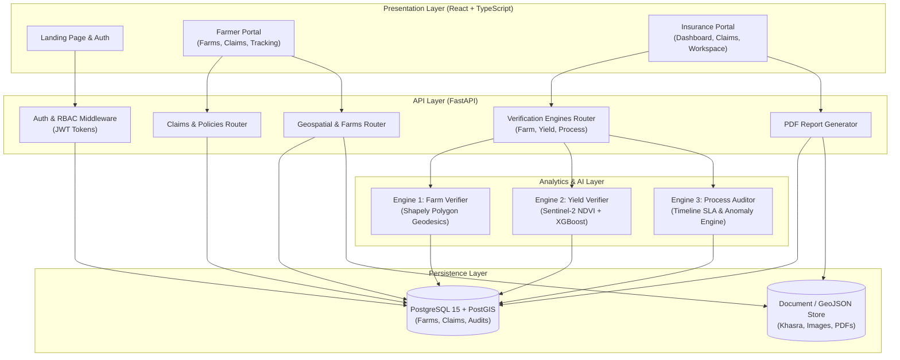
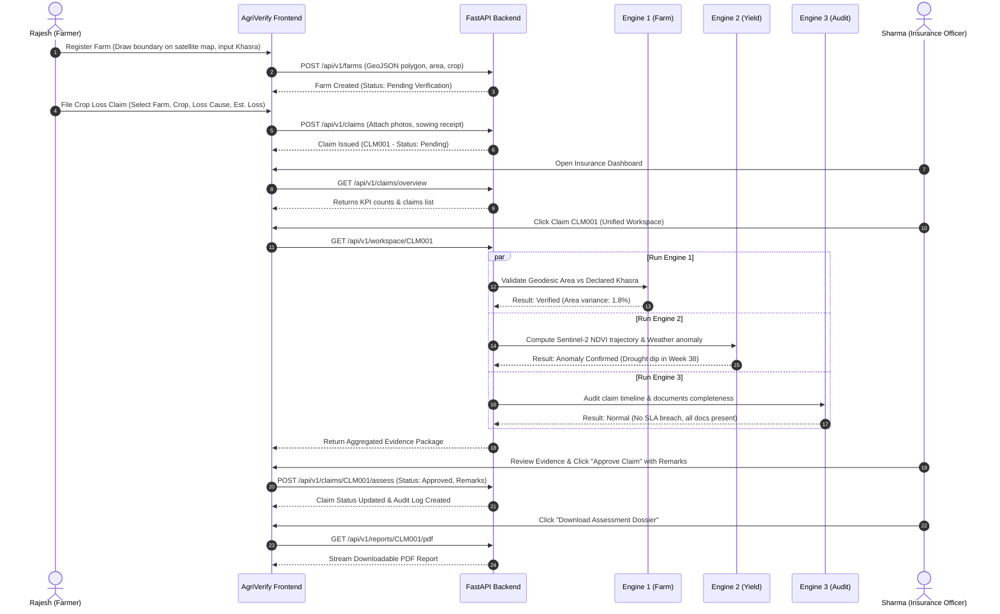

# AgriVerify AI – System Architecture Specification

## 1. High-Level System Architecture

AgriVerify AI is engineered as a modern, decoupled cloud-ready platform combining a reactive Single Page Application (SPA), high-performance asynchronous REST microservices, a PostGIS-enabled relational database, and geospatial analytics pipelines.

---

## 2. Component Breakdown

### 2.1 Frontend Client (React 18 + TypeScript + Vite)
- **Role-Based Routing:** Secured routes distinguishing between `farmer` and `insurance_officer`.
- **Geospatial Mapping:** Integrated with **Leaflet** and **OpenStreetMap / ESRI Satellite** for drawing and reviewing farm boundary polygons.
- **Data Visualizations:** Built with **Recharts** for rendering:
  - Multi-temporal NDVI vegetation index trends against district baselines.
  - Rainfall and temperature historical distributions.
  - Claim processing SLA duration breakdowns.
- **Unified Workspace Cockpit:** A responsive 6-panel grid providing synchronized inspection of geospatial, vegetative, meteorological, and audit records.

### 2.2 Backend Microservice (Python FastAPI)
- **Asynchronous Execution:** High-throughput async endpoints built on Starlette and Pydantic v2.
- **Authentication & RBAC:** OAuth2 with Password Bearer, cryptographically signed JWT tokens, and declarative role dependencies (`require_role('insurance_officer')`).
- **Geospatial Processing Engine:** Utilizes `shapely`, `pyproj`, and `GeoAlchemy2` to compute accurate geodesic polygon surface area in hectares and acres, accounting for ellipsoidal distortion.
- **Reporting Engine:** Headless PDF generation via `ReportLab` compiling comprehensive audit records into printable, verifiable claim dossiers.

### 2.3 Persistence & Spatial Storage (PostgreSQL + PostGIS)
- PostGIS extensions (`geometry(Polygon, 4326)`) allow spatial queries, boundary containment checks, and overlap detections between adjacent Khasra parcels.
- Fully normalized relational schema spanning 13 core tables with cascade constraints, check constraints, and timestamp audit triggers.

---

## 3. End-to-End Claim Lifecycle Sequence Diagram

---

## 4. Security & Compliance Architecture

1. **Role-Based Access Control (RBAC):**
   - Farmers cannot view or modify claims outside their own registered user identifier.
   - Only authorized `insurance_officer` roles can access verification engines and trigger claim decisions.
2. **Immutable Audit Trails:**
   - Every status alteration, document submission, and assessor decision generates a timestamped entry in `audit_logs` and `claim_events`.
3. **Fiduciary Safety:**
   - AI outputs are classified strictly as advisory evidence (`confidence_score`, `data_quality`). The platform enforces mandatory human sign-off for any claim disbursement or repudiation.
