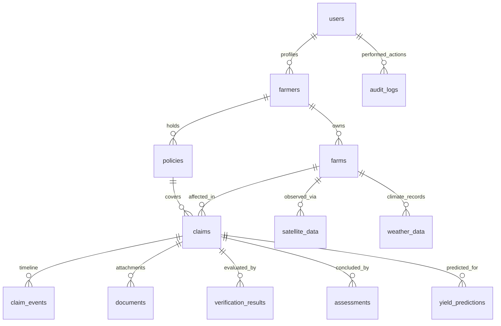

# AgriVerify AI – Database Schema & Data Dictionary

The persistence layer is built on **PostgreSQL 15+ with the PostGIS extension enabled**. It contains 13 relational tables supporting users, agricultural land parcels, insurance contracts, multi-engine verification metrics, and audit logging.

---

## 1. Entity-Relationship Overview

---

## 2. Table Specifications

### 2.1 `users`
Stores credentials, roles, and identity accounts.
- `id` (UUID, Primary Key)
- `email` (VARCHAR(255), Unique, Not Null)
- `hashed_password` (VARCHAR(255), Not Null)
- `full_name` (VARCHAR(150), Not Null)
- `phone` (VARCHAR(20))
- `role` (VARCHAR(30), Check: `farmer`, `insurance_officer`, `admin`)
- `is_active` (BOOLEAN, Default: TRUE)
- `created_at` (TIMESTAMPTZ, Default: NOW())
- `updated_at` (TIMESTAMPTZ, Default: NOW())

### 2.2 `farmers`
Extended agricultural profile for farmer users.
- `id` (UUID, Primary Key)
- `user_id` (UUID, Foreign Key -> `users.id`, Unique)
- `farmer_id_code` (VARCHAR(50), Unique, e.g. `FAR-MP-2026-081`)
- `aadhar_hash` (VARCHAR(64), Anonymized identifier)
- `village` (VARCHAR(100), Not Null)
- `sub_district_tehsil` (VARCHAR(100))
- `district` (VARCHAR(100), Not Null, e.g. `Bhopal`, `Sehore`, `Raisen`)
- `state` (VARCHAR(100), Default: `Madhya Pradesh`)
- `pincode` (VARCHAR(10))
- `created_at` (TIMESTAMPTZ, Default: NOW())

### 2.3 `farms`
Geospatial representation of agricultural plots.
- `id` (UUID, Primary Key)
- `farmer_id` (UUID, Foreign Key -> `farmers.id`)
- `farm_name` (VARCHAR(100), e.g. `Khasra 42/1 - North Field`)
- `khasra_number` (VARCHAR(50), Not Null)
- `declared_area_hectares` (NUMERIC(8, 4), Not Null)
- `geodesic_area_hectares` (NUMERIC(8, 4), Computed via PostGIS)
- `area_variance_percent` (NUMERIC(5, 2))
- `current_crop` (VARCHAR(50), e.g. `Wheat`, `Soybean`, `Paddy`)
- `season` (VARCHAR(20), e.g. `Rabi`, `Kharif`)
- `soil_type` (VARCHAR(50))
- `boundary_geojson` (JSONB, Not Null, GeoJSON Feature / Polygon)
- `geom` (GEOMETRY(Polygon, 4326), Spatial Index)
- `verification_status` (VARCHAR(30), Default: `Pending`, Check: `Verified`, `Mismatch`, `Insufficient Data`, `Manual Review`)
- `created_at` (TIMESTAMPTZ, Default: NOW())

### 2.4 `policies`
Insurance policy contracts covering specific crops and farms.
- `id` (UUID, Primary Key)
- `farmer_id` (UUID, Foreign Key -> `farmers.id`)
- `policy_number` (VARCHAR(50), Unique, e.g. `POL-2026-WHT-0491`)
- `scheme_name` (VARCHAR(100), e.g. `PM Fasal Bima Yojana - Comprehensive`)
- `sum_insured_inr` (NUMERIC(12, 2), Not Null)
- `premium_paid_inr` (NUMERIC(10, 2), Not Null)
- `coverage_start_date` (DATE, Not Null)
- `coverage_end_date` (DATE, Not Null)
- `status` (VARCHAR(30), Default: `Active`, Check: `Active`, `Claimed`, `Expired`, `Cancelled`)
- `created_at` (TIMESTAMPTZ, Default: NOW())

### 2.5 `claims`
Crop insurance damage claims filed by farmers or batch imported.
- `id` (UUID, Primary Key)
- `claim_number` (VARCHAR(50), Unique, e.g. `CLM001`)
- `farmer_id` (UUID, Foreign Key -> `farmers.id`)
- `farm_id` (UUID, Foreign Key -> `farms.id`)
- `policy_id` (UUID, Foreign Key -> `policies.id`)
- `loss_cause` (VARCHAR(100), e.g. `Drought`, `Unseasonal Rainfall`, `Pest Infestation`, `Hailstorm`)
- `claimed_loss_percentage` (NUMERIC(5, 2), e.g. 75.00)
- `claimed_amount_inr` (NUMERIC(12, 2), Not Null)
- `incident_date` (DATE, Not Null)
- `status` (VARCHAR(30), Default: `Pending`, Check: `Pending`, `Under Verification`, `Verified`, `Flagged`, `Delayed`, `Approved`, `Rejected`)
- `created_at` (TIMESTAMPTZ, Default: NOW())
- `updated_at` (TIMESTAMPTZ, Default: NOW())

### 2.6 `claim_events`
Sequential lifecycle milestones for process audit tracking.
- `id` (UUID, Primary Key)
- `claim_id` (UUID, Foreign Key -> `claims.id`)
- `stage` (VARCHAR(50), e.g. `Submission`, `Survey Scheduled`, `Engine Analysis`, `Officer Review`, `Approved`, `Disbursed`)
- `event_timestamp` (TIMESTAMPTZ, Not Null)
- `actor_user_id` (UUID, Foreign Key -> `users.id`, Nullable)
- `notes` (TEXT)
- `sla_status` (VARCHAR(30), Default: `On Time`, Check: `On Time`, `Delayed`, `Critical Delay`)

### 2.7 `documents`
Evidentiary files uploaded by farmers or assessors.
- `id` (UUID, Primary Key)
- `claim_id` (UUID, Foreign Key -> `claims.id`, Nullable)
- `farm_id` (UUID, Foreign Key -> `farms.id`, Nullable)
- `document_type` (VARCHAR(50), Check: `Khasra_Deed`, `Sowing_Certificate`, `Field_Photo`, `Soil_Report`, `Assessment_Dossier`)
- `file_name` (VARCHAR(255), Not Null)
- `file_url` (VARCHAR(500), Not Null)
- `file_size_bytes` (INTEGER)
- `mime_type` (VARCHAR(50))
- `uploaded_at` (TIMESTAMPTZ, Default: NOW())

### 2.8 `satellite_data`
Sentinel-2 multispectral and vegetative observations.
- `id` (UUID, Primary Key)
- `farm_id` (UUID, Foreign Key -> `farms.id`)
- `observation_date` (DATE, Not Null)
- `satellite_mission` (VARCHAR(50), Default: `Sentinel-2 L2A`)
- `cloud_coverage_percent` (NUMERIC(5, 2))
- `mean_ndvi` (NUMERIC(6, 4), Not Null)
- `min_ndvi` (NUMERIC(6, 4))
- `max_ndvi` (NUMERIC(6, 4))
- `band_b04_red` (NUMERIC(8, 4))
- `band_b08_nir` (NUMERIC(8, 4))
- `created_at` (TIMESTAMPTZ, Default: NOW())

### 2.9 `weather_data`
Meteorological daily observations for farm clusters.
- `id` (UUID, Primary Key)
- `district` (VARCHAR(100), Not Null)
- `record_date` (DATE, Not Null)
- `rainfall_mm` (NUMERIC(6, 2), Not Null)
- `temperature_max_c` (NUMERIC(4, 2))
- `temperature_min_c` (NUMERIC(4, 2))
- `soil_moisture_index` (NUMERIC(5, 3))
- `anomaly_flag` (BOOLEAN, Default: FALSE)

### 2.10 `yield_predictions`
AI-synthesized yield estimates from Engine 2.
- `id` (UUID, Primary Key)
- `claim_id` (UUID, Foreign Key -> `claims.id`)
- `crop_type` (VARCHAR(50), Not Null)
- `historical_benchmark_yield_kg_ha` (NUMERIC(8, 2))
- `reported_yield_kg_ha` (NUMERIC(8, 2))
- `estimated_yield_kg_ha` (NUMERIC(8, 2))
- `loss_severity_percent` (NUMERIC(5, 2))
- `model_confidence_score` (NUMERIC(4, 2), e.g. 0.88)
- `is_experimental` (BOOLEAN, Default: TRUE)
- `model_version` (VARCHAR(50), Default: `xgb-crop-v1.4`)
- `created_at` (TIMESTAMPTZ, Default: NOW())

### 2.11 `verification_results`
Combined structured outputs from Engines 1, 2, and 3.
- `id` (UUID, Primary Key)
- `claim_id` (UUID, Foreign Key -> `claims.id`)
- `engine_name` (VARCHAR(50), Check: `farm_verification`, `yield_verification`, `process_audit`)
- `verdict` (VARCHAR(50), e.g. `Verified`, `Mismatch`, `Anomaly Detected`, `Delayed`)
- `score` (NUMERIC(5, 2))
- `details_json` (JSONB, Full analytical payload)
- `created_at` (TIMESTAMPTZ, Default: NOW())

### 2.12 `assessments`
Human insurance assessor's formal adjudication.
- `id` (UUID, Primary Key)
- `claim_id` (UUID, Foreign Key -> `claims.id`, Unique)
- `assessor_id` (UUID, Foreign Key -> `users.id`)
- `decision` (VARCHAR(50), Check: `Approved`, `Rejected`, `Flagged_Investigation`, `More_Info_Required`)
- `approved_amount_inr` (NUMERIC(12, 2))
- `remarks` (TEXT, Not Null)
- `decision_date` (TIMESTAMPTZ, Default: NOW())

### 2.13 `audit_logs`
Tamper-evident log of administrative operations.
- `id` (UUID, Primary Key)
- `user_id` (UUID, Foreign Key -> `users.id`, Nullable)
- `action` (VARCHAR(100), e.g. `CLAIM_APPROVED`, `DOCUMENT_UPLOADED`, `CSV_BATCH_IMPORT`)
- `entity_type` (VARCHAR(50))
- `entity_id` (VARCHAR(100))
- `ip_address` (VARCHAR(45))
- `payload` (JSONB)
- `created_at` (TIMESTAMPTZ, Default: NOW())
